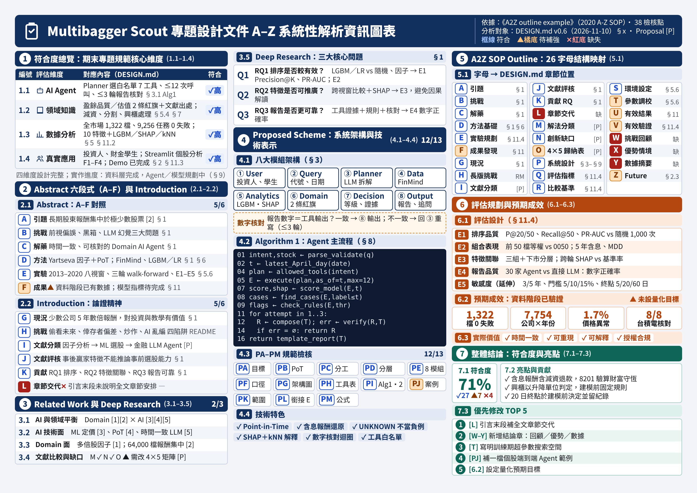

# Multibagger Scout｜提案與論文文件

台股潛力股探勘 AI Agent（Multibagger Scout）提案與 ICEIB 2027 研討會論文工作區。

## 文件總覽

| 文件 | 內容 |
| --- | --- |
| [ICEIB 2027 論文草稿 (LaTeX)](ICEIB%20paper/main.tex) | IEEE `IEEEtran` 雙欄研討會論文（5 頁，對應 A–Z 規範） |
| [ICEIB 2027 論文草稿 (純文字)](ICEIB%20paper/main.txt) | 完整英文研討會論文純文字版 |
| [OpenSpec 論文規格設定](openspec/config.yaml) | ICEIB + A–Z 寫作規範與 `000`–`006` 章節 Changes |
| [專業摘要](專業摘要.md) | 約 500 字專業摘要 |
| [專題設計規範檢核](專題設計規範檢核.md) | 依 A2Z outline（2020 A-Z SOP）逐章檢核提案與 DESIGN.md |
| [A–F 最新研究證據補強](Multibagger%20Scout%20A–F%20最新研究證據補強.md) | Abstract A–F 的最新研究數據、案例新聞與引用清單 |
| [A–Z 檢核資訊圖表](MultibaggerScout_A2Z_A4.png) | A4 橫式資訊圖表 |

原始 Word 檔（.docx）一併保留於本資料夾。

## A–Z 系統性解析資訊圖表

